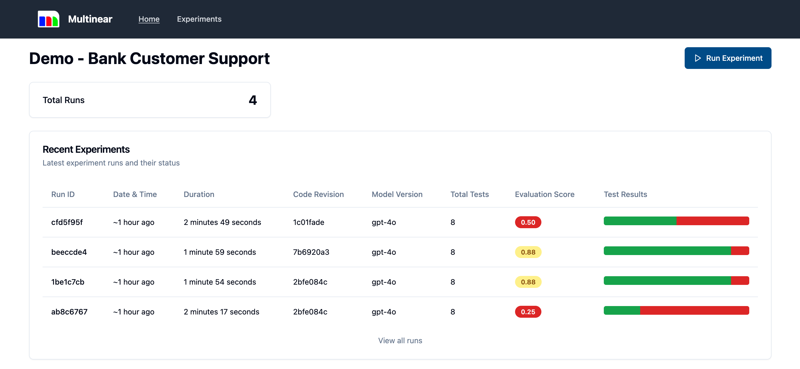
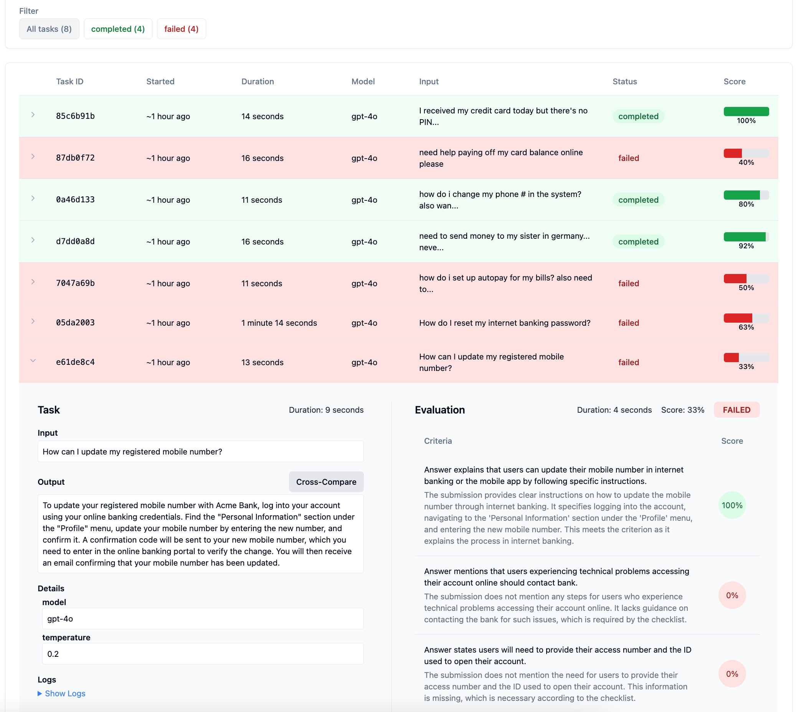

# Multinear: Reliable GenAI Applications

Developing reliable applications powered by Generative AI presents unique challenges. The unpredictable nature of LLMs often leads to inconsistent outputs, regressions, and unforeseen behaviors, especially when iterating on prompts, models, and datasets. **Multinear** is a platform designed to help you navigate these challenges by providing a systematic way to run experiments, measure results, and gain insights, ensuring your GenAI applications are robust and trustworthy.



## Why Multinear?

- **End-to-End Evaluation**: Assess the full spectrum of your GenAI application — from inputs to outputs — capturing the interactions between models, prompts, datasets, and business logic.
- **Experimentation Made Easy**: Run experiments with various configurations effortlessly. Test different models, tweak prompts, adjust datasets, and modify your code to find the optimal setup.
- **Regression Detection**: Identify when new changes negatively impact previously successful cases. Multinear tracks regressions so you can maintain and improve application reliability over time.
- **Comprehensive Evaluation Methods**: Use a range of evaluation strategies, including strict output comparisons, LLM-as-a-judge assessments, and human evaluations, to ensure your application meets quality standards.
- **Insightful Analytics**: Compare results across different runs to understand the impact of changes. Visualize performance trends and make data-driven decisions to enhance your application.
- **Guardrail Testing**: Strengthen your application against malicious inputs, security threats, and safety concerns by evaluating it under challenging scenarios.

## Overview

Multinear is a simple workflow for evaluating GenAI apps:

- Define tasks and criteria in `.multinear/config.yaml`.
- Run from the CLI or web UI and watch progress in real time.
- Mix evaluators (checklist, weighted, list, or custom Python) per task.
- Group tasks to focus on specific areas and run subsets.
- Inspect detailed results with captured logs and rationales.

See the Configuration and Evaluators sections for concrete examples.

## Project Initialization

Initialize a new Multinear project in your project folder:

```bash
pip install multinear
multinear init
```

You'll be prompted to enter your project details:

- **Project Name**: A descriptive name for your project.
- **Project ID**: A URL-friendly identifier (default provided).
- **Project Description**: A brief summary of your project's purpose.

This command creates a `.multinear` folder containing your project configuration and an SQLite database for experiment results. It's recommended to commit this folder alongside your code to keep track of your evaluations.

## Running the Platform

Start the Multinear web server to access the interactive frontend:

```bash
multinear web
```
Access the platform at `http://127.0.0.1:8000` in your browser.

For development mode with auto-reload on file changes, use:

```bash
multinear web_dev
```

### Defining Your Task Runner

Create a `task_runner.py` in the `.multinear` folder of your project. This file defines the `run_task(input)` function, which contains the logic for processing each task using your GenAI application.

Example `task_runner.py`:

```python
def run_task(input):
    # Your GenAI-powered application logic here
    output = my_application.process(input)  # If your app is standalone, expose an API and call it here to get the output
    details = {'model': 'gpt-4o'}
    return {'output': output, 'details': details}
```

### Configuring Tasks and Evaluations

Define your tasks and evaluation criteria in `.multinear/config.yaml`.

Example `config.yaml`:

```yaml
project:
  id: my-genai-project
  name: My GenAI Project
  description: Experimenting with GenAI models

meta:
  context: |
    This is a global context that will be injected into each task evaluation.
    It's important to include any useful information that may be needed to evaluate each result.

tasks:
  - id: task1
    input: Input data for task 1
    checklist:
      - The output should be in English.
      - The response should be polite.
      - The response should be less than 500 words.
    # Overall score, some checklist items can completely fail, and still pass if the majority pass
    # (in this case, 2/3 items will pass)
    min_score: 0.6
  - id: task2
    input: "Input data for task 2"
    checklist:
      - The output should include at least two examples.
      - The response should be less than 500 words.
      - text: Tests can have individual minimum scores, as sometimes it's hard to compose an assertion that is both comprehensive and easy to evaluate.
        min_score: 0.5  # Individual checklist item score
```

### Running Experiments

You can run experiments either through the command line interface (CLI) or the web frontend.

#### Using the Frontend

1. Start the web server if not already running:
```bash
multinear web
```

2. Open `http://127.0.0.1:8000` in your browser

3. Click "Run Experiment" to start an experiment

The frontend provides:
- Real-time progress tracking
- Interactive results visualization
- Detailed task-level information
- Ability to compare multiple runs



#### Using the CLI

Run an experiment using the `run` command:

```bash
multinear run
```

This will:
- Start a new experiment run
- Show real-time progress with a progress bar
- Display current status and results
- Save detailed output to `.multinear/last_output.txt`

View recent experiment results:
```bash
multinear recent
```

Get detailed information about a specific run:
```bash
multinear details <run-id>
```

## Analyzing Results

Once the experiment run is complete, you can analyze the results via the frontend dashboard. The platform provides:

- **Run Summaries**: Overview of each experiment run, including total tasks, passed/failed counts, and overall score.
- **Detailed Reports**: Drill down into individual tasks to see input, output, logs, and evaluation details.
- **Trend Analysis**: Compare results across runs to identify improvements or regressions.
- **Filter and Search**: Find specific tasks or runs based on criteria such as challenge ID, date, or status.

## Config Reference

Multinear reads `.multinear/config.yaml`. You can define a flat `tasks:` list or organize tasks into `groups:`. Below is the supported structure with examples.

### Top‑level keys:

```yaml
project:            # Required project metadata
  id: my-project
  name: My Project
  description: Demo

meta:               # Optional: defaults and execution controls
  repeat: 1         # Default repeats per task (int)
  rephrase: false   # Rephrase inputs for repeats via OpenAI
  max_workers: 1    # Parallel workers for concurrent execution
  context: |        # Shared context injected into evaluators
    Shared evaluation context here
  fail_simulate: 0  # Optional float (0..1) to simulate failures for testing
  # Optional evaluator defaults for single‑metric tasks
  # checklist: [...]
  # custom: { ... }

# Choose one style: grouped or flat
groups:
  - id: retrieval
    name: Retrieval checks
    description: Validate RAG answers and structure
    tasks: [ ... ]  # See Task object below

# Flat mode (alternative to groups)
tasks:
  - { ... }
```

### Task object examples:

#### Single‑metric task (choose one evaluator block):

```yaml
tasks:
  - id: task-1                              # Optional; auto‑derived sha256(input) if omitted
    input: "Summarize the process in simple terms."  # String or object. If object has `question`, only that key is rephrased
    min_score: 0.7                           # Optional: pass threshold (default 1.0)
    repeat: 1                                # Optional: override meta.repeat
    rephrase: false                          # Optional: override meta.rephrase
    context: "Audience: non‑experts"         # Optional: appended after meta.context (single‑metric only)

    # Checklist evaluator (active example)
    checklist:
      - text: Response is in English
      - text: Tone is polite
      - text: Uses 2–3 concise bullet points
        min_score: 0.5                      # Optional per‑item min; >= min counts as full pass

    # weighted_score:                       # Alternative (commented)
    #   - { id: accuracy,  eval: "Technically accurate",  weight: 0.5 }
    #   - { id: clarity,   eval: "Clear to layperson",    weight: 0.3 }
    #   - { id: brevity,   eval: "<= 200 words",          weight: 0.2 }
    # min_score: 0.7                         # Optional
    # context: "Evaluation context"          # Optional

    # list:                                  # Alternative (commented)
    #   path: "$.payload.required_keys"      # Optional: JSONPath into output
    #   includes: ["id", "email"]
    #   excludes: ["password"]
    #   max_length: 10
    # min_score: 1.0                          # Optional

    # numeric:                               # Alternative (commented)
    #   expected: 0.85
    #   method: tolerance                     # One of: direct_diff | mse | rmse | tolerance | range
    #   absolute_tolerance: 0.05              # Or use relative_tolerance
    #   # Optional helpers:
    #   # path: "$.score"
    #   # extraction_hint: "the AUC"
    #   # preprocessing: strip_spaces
    # min_score: 1.0                          # Optional

    # custom:                                # Alternative (commented)
    #   min_score: 0.7                        # Optional
    #   checks:
    #     - name: Has greeting
    #       criterion: "Contains 'Hello'"
    #       type: contains
    #       value: "Hello"
    #     - name: Max length 200
    #       criterion: "<= 200 characters"
    #       type: max_length
    #       value: 200
    # # Note: custom is additive; pair it with another evaluator for best results.
```

#### Multi‑metric task (average score; all metrics must pass):

```yaml
tasks:
  - id: task-2
    input: "Answer and cite at least two sources."
    # Optional: shared context across metrics (use meta.context for multi‑metric)
    # meta:
    #   context: "Enterprise tone"
    metrics:
      - type: checklist
        checklist:
          - text: Cites at least 2 sources
          - text: Avoids marketing buzzwords
        min_score: 0.6                      # Optional per‑metric threshold
        context: "Formal tone"               # Optional per‑metric context
      - type: weighted_score
        weighted_score:
          - { id: structure, eval: "Structured sections", weight: 0.4 }
          - { id: facts,     eval: "Factual accuracy",  weight: 0.6 }
        min_score: 0.7
```

Challenge IDs:
- If `id` is omitted, Multinear derives it as `sha256(input)`.
- When `repeat > 1`, subsequent repeats append `_<n>` (e.g., `_1`, `_2`).

#### Groups example:

```yaml
groups:
  - id: rag
    name: RAG
    description: Retrieval‑augmented generation checks
    tasks:
      - id: rag-basic
        input: { question: "What is vector search?" }
        checklist:
          - text: Mentions dense embeddings
          - text: Explains approximate nearest neighbors (ANN)
        min_score: 0.6
```

### Evaluator blocks

#### Checklist (LLM‑as‑judge with per‑item scoring):

Uses an LLM to score each checklist item (0–1) with a rationale, then averages across items. You can set per‑item `min_score` to grant full credit when met and pass optional `context` (appended after `meta.context`).

```yaml
tasks:
  - id: checklist-demo
    input: "Summarize the process."
    context: "Audience: non‑experts"  # Optional: appended after meta.context
    checklist:
      - text: Response is in English
      - text: Tone is polite
      - text: Under 200 words; min_score: 0.5  # Optional per‑item min; >= min counts as full pass
    min_score: 0.7  # Optional pass threshold (default 1.0)
```

#### Weighted Score (multi‑criterion with weights):

Scores multiple criteria and combines them using your weights to produce a final 0–1 score. Returns per‑criterion rationales; weights don’t need to sum to 1 (the evaluator normalizes by total weight).

```yaml
tasks:
  - id: weighted-demo
    input: "Explain vector search to a PM."
    weighted_score:
      - { id: accuracy,  eval: "Technically accurate",  weight: 0.5 }
      - { id: clarity,   eval: "Clear to layperson",    weight: 0.3 }
      - { id: brevity,   eval: "Brevity (<= 200 words)", weight: 0.2 }
    min_score: 0.7        # Optional
    # context: "Evaluation context"  # Optional
```

#### List (structural checks over arrays):

Validates list structure/content in the output. Target the list via optional JSONPath `path`, then require items (`includes`), forbid items (`excludes`), and enforce `max_length`; non‑list values fail.

```yaml
tasks:
  - id: list-demo
    input: { payload: { required_keys: ["id", "email", "role"] } }
    list:
      path: "$.payload.required_keys"   # Optional JSONPath into the output
      includes: ["id", "email"]
      excludes: ["password"]
      max_length: 10
    min_score: 1.0  # Optional
```

#### Custom (user‑defined Python in `.multinear/task_runner.py`):

A Python hook to implement domain‑specific checks. Return a dict with `score` and `metadata.evaluations`; use alongside another evaluator when you want both LLM judgment and deterministic rules.

```yaml
tasks:
  - id: custom-demo
    input: "Hello, this is a short response about vectors."
    # Note: custom is additive; pair it with another evaluator when needed
    checklist:
      - text: Mentions 'vector' (case-insensitive); min_score: 0.5
    custom:
      min_score: 0.7  # Optional
      checks:
        - name: Has greeting
          criterion: "Contains 'Hello'"
          type: contains
          value: "Hello"
        - name: Max length 200
          criterion: "<= 200 characters"
          type: max_length
          value: 200
```

Minimal `.multinear/task_runner.py` shape:

```python
# .multinear/task_runner.py
from typing import Any, Dict, List


def _score_bool(ok: bool) -> float:
    return 1.0 if ok else 0.0


def evaluate_custom(input: Any, output: Any, spec: Dict) -> Dict:
    """
    Example custom evaluator matching the YAML `custom:` block above.
    Supports check types: contains, icontains, max_length, min_length.
    """
    checks: List[Dict] = spec.get("checks", [])

    # Normalize output to string for simple checks
    out_text = output if isinstance(output, str) else str(output)

    evaluations: List[Dict] = []
    total = 0.0

    for chk in checks:
        ctype = chk.get("type")
        crit = chk.get("criterion") or chk.get("name") or "Unnamed check"
        val = chk.get("value")

        ok = False
        rationale = ""

        try:
            if ctype == "contains":
                ok = (val or "") in out_text
                rationale = f"{'Found' if ok else 'Missing'} substring: {val!r}"
            elif ctype == "icontains":
                ok = (val or "").lower() in out_text.lower()
                rationale = f"{'Found' if ok else 'Missing'} substring (case-insensitive): {val!r}"
            elif ctype == "max_length":
                limit = int(val)
                ok = len(out_text) <= limit
                rationale = f"Length {len(out_text)} / {limit}"
            elif ctype == "min_length":
                limit = int(val)
                ok = len(out_text) >= limit
                rationale = f"Length {len(out_text)} >= {limit}"
            else:
                rationale = f"Unknown check type: {ctype}"
        except Exception as e:
            ok = False
            rationale = f"Check error: {e}"

        s = _score_bool(ok)
        total += s
        evaluations.append({
            "criterion": crit,
            "score": s,
            "rationale": rationale,
        })

    # Average score across checks; empty list -> 0.0
    overall = (total / len(evaluations)) if evaluations else 0.0

    result = {
        "score": overall,
        "metadata": {
            "evaluations": evaluations,
            "overall_score": overall,
        },
    }

    # Optional pass honoring custom min_score if provided in spec
    if isinstance(spec.get("min_score"), (int, float)):
        result["passed"] = overall >= float(spec["min_score"])

    return result
```

Notes:
- Merging: Multinear merges custom results assuming a dict return type with `metadata.evaluations`. Returning a `Score` object will not merge rationales correctly.
- Combination: When combined with another evaluator, Multinear averages the custom `score` with the primary evaluator’s score and concatenates both `metadata.evaluations` lists.
- Additive: Use custom alongside another evaluator (e.g., checklist + custom) rather than as a standalone replacement.

#### Numeric (extract and compare numbers):

Extracts a numeric value from output (regex, JSONPath, or with an LLM hint) and compares it to an expected value. Supports `direct_diff`, `mse`, `rmse`, `tolerance`, and `range` methods for flexible numeric validation.

```yaml
tasks:
  - id: numeric-demo
    input: "The AUC achieved was 0.87 on the validation set."
    numeric:
      expected: 0.85
      method: tolerance               # direct_diff | mse | rmse | tolerance | range
      absolute_tolerance: 0.05        # Or use relative_tolerance
      # Optional helpers:
      # path: "$.score"
      # extraction_hint: "the AUC"
      # preprocessing: strip_spaces
    min_score: 1.0  # Optional
```

Pass/fail semantics:
- Single‑metric: pass if `score >= min_score` (default `min_score: 1.0`).
- Multi‑metric: overall score is average; pass only if all metrics pass.

## Architecture

Multinear consists of several components:

- **CLI (`cli/` folder)**: Command-line interface for initializing projects and starting the web server.
- **Web Server (`main.py`)**: A FastAPI application serving API endpoints and static Svelte frontend files.
- **Engine (`engine/` folder)**:
  - **Run Management (`run.py`)**: Handles execution of tasks and evaluation.
  - **Storage (`storage.py`)**: Manages data models and database operations using SQLAlchemy.
  - **Evaluation (`evaluate.py`, `checklist.py`)**: Provides evaluation mechanisms for task outputs.
- **API (`api/` folder)**: Defines API routes and schemas for interaction with the frontend.
- **Utilities (`utils/capture.py`)**: Captures task execution output and logs.
- **Frontend**: A Svelte-based interface for interacting with the platform (located in `multinear/frontend/`).

## Development

To install Multinear and its dependencies for local development, run:

```bash
git clone https://github.com/multinear/multinear
cd multinear
make install
```

This will install the required Python packages.

## Contributing

Contributions are welcome! To contribute:

1. Fork the repository.
2. Create a new branch for your feature or bugfix.
3. Make your changes with clear commit messages.
4. Submit a pull request to the `main` branch.

Please ensure that your code adheres to the project's coding standards and passes all tests.

## License

Multinear is released under the [MIT License](LICENSE). You are free to use, modify, and distribute this software as per the terms of the license.
